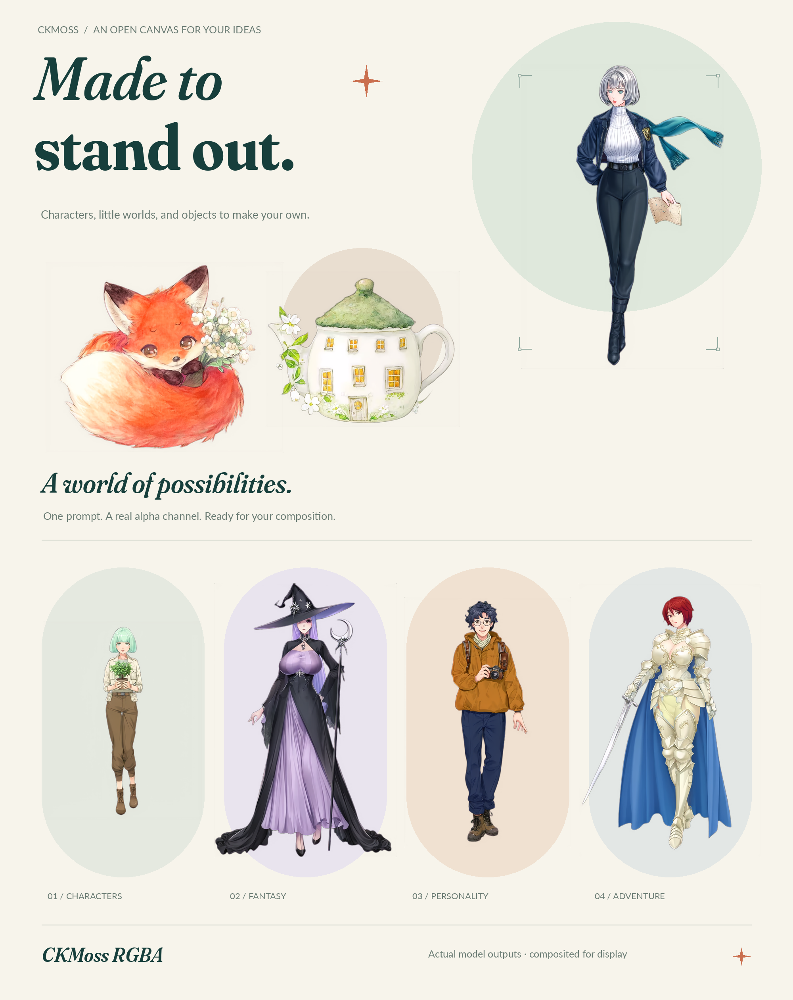

<p align="center"></p>

<p align="center"><b>Characters, illustrations, and little objects — ready for your composition.</b></p>
<p align="center"><a href="README.md">中文</a> · English · <a href="https://huggingface.co/ChenkinLab/CKMoss-Image-RGBA">Download models</a> · <a href="https://github.com/Chenkin-x/CKMoss-Image-RGBA">Model code</a></p>
<p align="center">Author: <a href="https://github.com/chinoll">chinoll</a></p>

Generate RGBA images with MOSS-Image and save PNG files with an alpha channel, using ComfyUI's normal model loading, prompting, and sampling nodes.

**The DiT LoRA is optional.** The original MOSS-Image model can generate images with this RGBA VAE alone. The optional DiT LoRA adapts MOSS-Image-SFT for transparent-image generation. Transparency and edge quality vary with the prompt and combination.

## Install

1. Update ComfyUI and prepare the base model and text encoder using the [official MOSS-Image instructions](https://github.com/OpenMOSS/MOSS-Image/blob/main/comfyui/README.md).
2. Clone this repository into `ComfyUI/custom_nodes/`:

   ```bash
   cd ComfyUI/custom_nodes
   git clone https://github.com/Chenkin-x/ComfyUI-CKMoss-Image-RGBA.git
   ```

3. Restart ComfyUI. This package requires no additional Python dependencies.

The entry point should be `ComfyUI/custom_nodes/ComfyUI-CKMoss-Image-RGBA/__init__.py`.

## Download weights

Both files live in [one HF repository](https://huggingface.co/ChenkinLab/CKMoss-Image-RGBA/tree/main).

| File | Destination | Purpose |
| --- | --- | --- |
| [moss_rgba_vae.safetensors](https://huggingface.co/ChenkinLab/CKMoss-Image-RGBA/resolve/main/vae/moss_rgba_vae.safetensors) | `ComfyUI/models/vae/` | Required; merged RGBA VAE |
| [moss_rgba_dit_lora.safetensors](https://huggingface.co/ChenkinLab/CKMoss-Image-RGBA/resolve/main/loras/moss_rgba_dit_lora.safetensors) | `ComfyUI/models/loras/` | Optional LoRA for MOSS-Image-SFT |

These are a VAE and an adapter. You also need the MOSS-Image base model and its text encoder.

## Generate

Drag a workflow JSON into ComfyUI:

- [RGBA VAE only](workflows/vae_only.json): no DiT LoRA.
- [RGBA VAE + DiT LoRA](workflows/with_lora.json): uses `Load LoRA (Model Only)`, with strength `1.0`.

Choose your MOSS-Image-SFT model in `Load Diffusion Model`, its text encoder in `Load CLIP`, and `moss_image` as the CLIP type. Choose this project's VAE in **Load MOSS RGBA VAE**.

Describe the subject, appearance, pose, and style. You can append `transparent background`. The examples use Euler, 30 steps, CFG 4, and dimensions divisible by 16.

**VAE Decode → Save Image** preserves the RGBA PNG. For separate color and mask processing, use **Split RGBA Image**. Its mask follows ComfyUI conventions: white is transparent, black is opaque. Use `Join Image with Alpha` to combine them again.

Examples below were generated with the RGBA VAE and DiT LoRA. Display backgrounds and checkerboards are separate from the original PNG files.



## Credits

Built on [MOSS-Image](https://github.com/OpenMOSS/MOSS-Image) and the [FLUX.2 VAE](https://github.com/black-forest-labs/flux2#flux2-autoencoder). Thanks to [niangao2331](https://github.com/niangao2331) for contributing part of the image data.

This repository's code is licensed under [GPLv3](LICENSE). The upstream [MOSS-Image](https://huggingface.co/OpenMOSS-Team/MOSS-Image-SFT/blob/main/LICENSE) and [FLUX.2 VAE](https://github.com/black-forest-labs/flux2#flux2-autoencoder) models are released under Apache 2.0; see the linked upstream license information.
